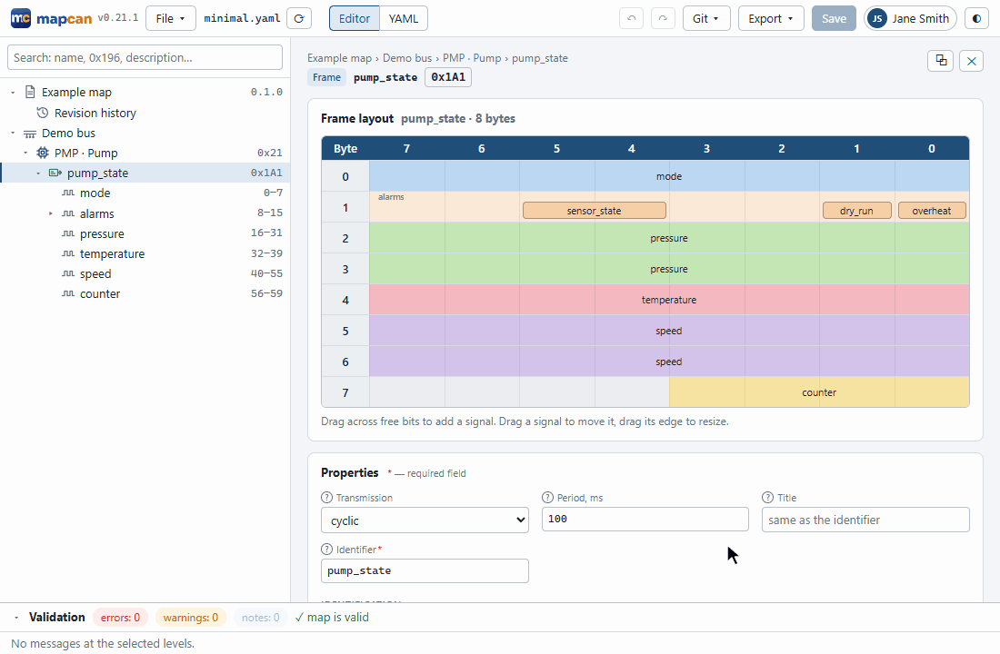
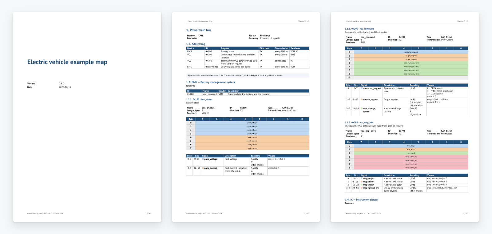
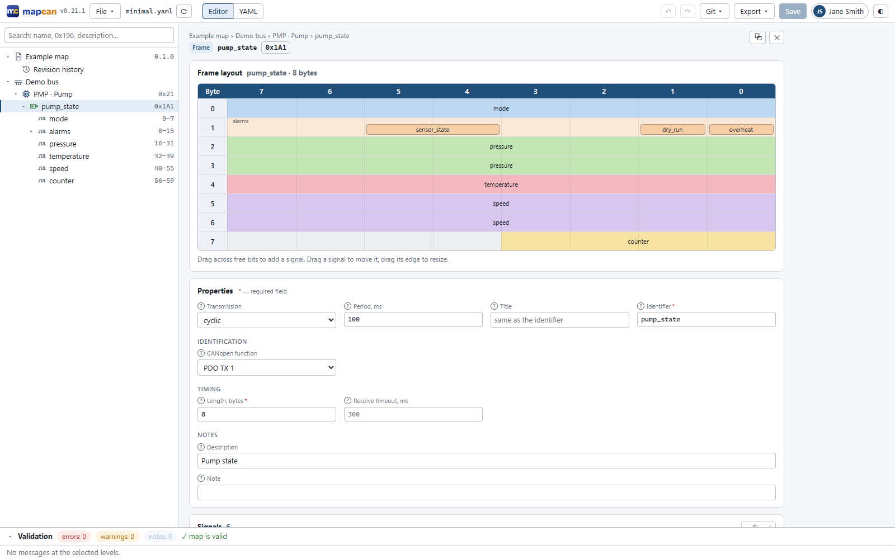
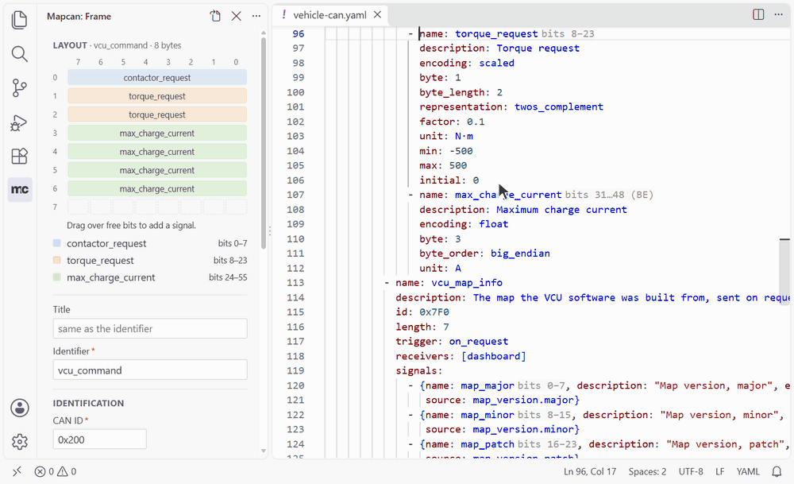

<p align="center">
  <picture>
    <source media="(prefers-color-scheme: dark)" srcset="docs/logo-dark.svg">
    
  </picture>
</p>

<p align="center">
  <b>A free, open-source CAN database editor.</b><br>
  Draw signals on the bit layout, keep the map in git, and get DBC, PDF, Excel and C code from one file.
</p>

<p align="center">
  <a href="https://github.com/ordu1453/mapcan/actions/workflows/ci.yml"></a>
  <a href="https://pypi.org/project/mapcan/"></a>
  <a href="https://marketplace.visualstudio.com/items?itemName=ordu1453.mapcan"></a>
  
  <a href="LICENSE"></a>
</p>

<p align="center">
  CAN 2.0A/B · CAN FD · SAE J1939 · CANopen · Windows, Linux, VS Code
</p>

<p align="center">
  <a href="#already-have-a-dbc">Try it on your DBC</a> ·
  <a href="#why-not-just-a-dbc-file">Why not just DBC</a> ·
  <a href="#installation">Installation</a> ·
  <a href="#outputs">Outputs</a> ·
  <a href="#documentation">Documentation</a>
</p>

<p align="center">
  <picture>
    <source media="(prefers-color-scheme: dark)" srcset="docs/images/demo-dark.gif">
    
  </picture>
</p>

Your CAN interface is described three times: in a spreadsheet or a Word document for the team, in a DBC for
the bus analyzer and in the firmware's headers. Sooner or later they disagree, and nobody knows which one is
right. **mapcan** keeps the interface in one YAML file and generates the rest from it, so they cannot drift
apart. The file is reviewed in pull requests like code, and every mistake (overlapping signals, clashing IDs,
unknown receivers) is reported with its line before anything is built.

## Already have a DBC?

```sh
pipx install "mapcan[desktop]"              # or the Windows installer below
mapcan import dbc vehicle.dbc               # → vehicle.yaml
mapcan validate vehicle.yaml                # what your DBC got wrong, with lines
mapcan build vehicle.yaml -o build/         # PDF, Excel, HTML, DBC, C and Python at once
mapcan app vehicle.yaml                     # edit it on the bit layout
```

The app, the web editor (**File → Import DBC…**) and the VS Code extension (**mapcan: Import DBC…**)
import a DBC too.

You keep your tools: the DBC exported back works in CANalyzer, SavvyCAN, PCAN-View and Wireshark.

## Why not just a DBC file?

| | DBC | Spreadsheet / Word | mapcan |
|---|:---:|:---:|:---:|
| Readable `git diff`, review in pull requests | partly: editors reorder the file | no | ✅ comments and order are kept |
| Overlaps, clashing IDs, unknown receivers caught | in some editors | no | ✅ as you type and in CI |
| J1939 PGNs and addresses, CANopen node IDs and PDOs | attributes by convention | free text | ✅ part of the format |
| A specification for people (PDF, Excel, HTML) | no | ✅ written by hand | ✅ generated |
| C `pack`/`unpack` for firmware, Python for test benches | with third-party tools | no | ✅ |
| Works in CANalyzer, SavvyCAN, Wireshark | ✅ | no | ✅ exports DBC |
| One system split into several files | no | separate files, kept in sync by hand | ✅ includes |

## Who it is for

* **Firmware engineers:** generated C with IDs, enums, structs and `pack`/`unpack`, no dynamic memory.
* **Test and validation:** a Python module with the same frames for test benches, and a DBC for the analyzer.
* **Systems engineers and leads:** one reviewed source of truth, and a PDF or Excel specification for suppliers
  and customers, also in Russian and to ESKD/GOST.

## Installation

| Platform | How |
|---|---|
| **Windows** | `mapcan-X.Y.Z-setup.exe` from [Releases](https://github.com/ordu1453/mapcan/releases/latest): no Python or administrator rights needed |
| **Linux x64** | `mapcan-X.Y.Z-linux-x64.tar.gz` from [Releases](https://github.com/ordu1453/mapcan/releases/latest): run `mapcan/mapcan-app` or `mapcan/mapcan` |
| **Any OS, Python 3.12+** | `uv tool install "mapcan[desktop]"` or `pipx install "mapcan[desktop]"` |
| **VS Code** | The extension from the [Marketplace](https://marketplace.visualstudio.com/items?itemName=ordu1453.mapcan) or [Open VSX](https://open-vsx.org/extension/ordu1453/mapcan): it installs mapcan by itself |
| **CI** | `pip install mapcan` (the core) or the Docker image `ghcr.io/ordu1453/mapcan:<version>` |

<details>
<summary>Optional parts, the Windows installer, offline installs, moving from canmap</summary>

**Optional parts.** `pip install mapcan` is the core: validation, DBC, EDS, Markdown, HTML, C and Python
code, enough for CI and firmware builds. Extras add `web` (the editor in a browser), `pdf`, `xlsx`, `lsp`
(the language server for editors), `desktop` (the app with all its exports) and `all`. A command that
needs a missing part says which one to install.

**Windows installer.** It adds mapcan to the Start menu, the desktop and "Open with" for `.yaml` files,
and optionally the `mapcan` command to `PATH`. A double-clicked map opens in the window already running,
and the editor announces new versions. The portable `mapcan-X.Y.Z-windows-x64.zip` needs no install. The
installer is not code-signed, so SmartScreen may warn: **More info → Run anyway**.

**Offline.** On a machine with access, `pip wheel . -w wheelhouse`; copy the folder and run
`pip install --no-index --find-links wheelhouse mapcan`.

**From canmap.** The tool used to be called canmap. The Windows installer upgrades it by itself; with
uv or pipx, `uv tool uninstall canmap` and install again. Settings move from `~/.canmap` to `~/.mapcan`;
maps need the key `mapcan: 1` in place of `canmap: 1` (`mapcan migrate` then rewrites them in version 2).
</details>

## Quick start

```sh
mapcan app                                  # the editor in its own window
```

Click **New map…** and pick a template (CANopen, J1939, CAN with explicit IDs or empty), or open one of
the examples. Add devices, frames and signals in the tree and draw signals on the frame's bit layout;
mistakes show up as you type. On the command line:

```sh
mapcan validate my-map.yaml                 # errors with file, line and column
mapcan build my-map.yaml -o build/          # every output at once
```

## Outputs

| | Output | Command |
|---|---|---|
| 📄 | PDF: title page, contents, bit diagrams, tables (also ESKD/GOST) | `mapcan export pdf` |
| 📊 | Excel: addressing, contents, bit layouts, changes | `mapcan export xlsx` |
| 📝 | Markdown for a README or wiki, HTML with search | `mapcan export md` / `html` |
| 🔌 | DBC for CANalyzer, SavvyCAN, PCAN-View, Wireshark | `mapcan export dbc` |
| 🧩 | EDS of each CANopen device | `mapcan export eds` |
| ⚙️ | C: IDs, enums, structs, `pack`/`unpack`; no dynamic memory | `mapcan gen c` |
| 🐍 | Python module for tests and test benches | `mapcan gen py` |
| 🔀 | Comparison of two versions, changelog | `mapcan diff` |
| 📥 | A map from an existing DBC, or a CANopen device from its EDS or DCF | `mapcan import dbc`, `mapcan import eds` |

<p align="center">
  <picture>
    <source media="(prefers-color-scheme: dark)" srcset="docs/images/document-pages-dark.png">
    
  </picture>
</p>

Documents are produced in English or Russian, with your logo and templates;
[docs/cli.md](docs/cli.md) has every command, the generated C code and the customization.

## Editors

**The mapcan app** (`mapcan app`, or `mapcan serve` in a browser) edits a map in forms that adapt to the
protocol and on the bit layout: drag across free bits to add a signal, drag a signal to move it. It
checks the map as you type, previews every output and compares versions from git. Files keep their
comments and formatting, so a diff shows only what you changed. More in [docs/web.md](docs/web.md).

<p align="center">
  <picture>
    <source media="(prefers-color-scheme: dark)" srcset="docs/images/web-frame-dark.png">
    
  </picture>
</p>

**VS Code** with the [mapcan extension](https://marketplace.visualstudio.com/items?itemName=ordu1453.mapcan)
checks maps as you type and adds the Map view, the Node panel with the bit layout, hovers, quick fixes,
rename, export and the map's history ([vscode/README.md](vscode/README.md)). Any editor with a YAML
language server completes keys from the [JSON Schema](docs/format.md).

<p align="center">
  <picture>
    <source media="(prefers-color-scheme: dark)" srcset="docs/images/vscode-demo-dark.gif">
    
  </picture>
</p>

## A map

```yaml
mapcan: 2

document:
  title: Electric vehicle example map
  version: 0.1.0
  language: en

buses:
  - name: powertrain
    bitrate: 500000
    protocol: can
    devices:
      - name: bms
        frames:
          - name: bms_status
            id: 0x100
            length: 8
            cycle_ms: 100
            receivers: [vcu]
            signals:
              - {name: pack_voltage, byte: 0, encoding: number, representation: float, unit: V, min: 0, max: 1000}
              - {name: pack_current, byte: 4, encoding: number, representation: float, unit: A, initial: 0}
      - name: vcu
```

The [examples](examples/) cover each protocol: [minimal.yaml](examples/minimal.yaml) (every kind of
signal in one CANopen frame), [j1939.yaml](examples/j1939.yaml), [canopen-node.yaml](examples/canopen-node.yaml)
(PDOs mapped to CiA 402 objects), [vehicle-can.yaml](examples/vehicle-can.yaml) (explicit IDs, CAN FD,
multiplexing) and [tractor/](examples/tractor/tractor.yaml) (a map in two files).

## Documentation

* **[Map format](docs/format.md)**: every field, the rules, included files, versioning.
* **[Command line](docs/cli.md)**: commands, validation, generated code, document customization, DBC, EDS and DCF import.
* **[Web editor](docs/web.md)**: the app, browser mode and its security, keyboard shortcuts, HTTP API.
* **[VS Code extension](vscode/README.md)**: features, settings, commands.
* **[PDF templates](docs/templates.md)**: ESKD/GOST details, logos, fonts, custom templates.
* **[CI](docs/ci-example.md)**: validating maps and building outputs in a pipeline.
* **[Contributing](CONTRIBUTING.md)** and **[Architecture](ARCHITECTURE.md)**: setup, tests, releases, how
  the code is organized.

## Roadmap

The [1.0 milestone](https://github.com/ordu1453/mapcan/milestone/1) holds what comes before the format is
declared stable. Next is a live bus: adapters, log decoding and replay, a monitor of signal values and a
simulator ([dashboard issues](https://github.com/ordu1453/mapcan/issues?q=is%3Aissue+is%3Aopen+label%3Adashboard)).
Ideas and bug reports are welcome in [issues](https://github.com/ordu1453/mapcan/issues).

## License

mapcan is free and open source under the [Apache License 2.0](LICENSE), copyright 2026 Ali Ordu
([NOTICE](NOTICE)). Files generated from your map (code, DBC, documents) are yours to use under any
terms, including closed-source firmware. The [format specification](docs/format.md) is under
[CC BY 4.0](https://creativecommons.org/licenses/by/4.0/), and the [JSON Schema](schema/) and the
[examples](examples/) under [CC0 1.0](https://creativecommons.org/publicdomain/zero/1.0/): anyone may
build tools for the format. Bundled components are listed in [THIRD_PARTY_NOTICES.md](THIRD_PARTY_NOTICES.md).

If mapcan helps your project, a star or a citation ([CITATION.cff](CITATION.cff)) is much appreciated.
